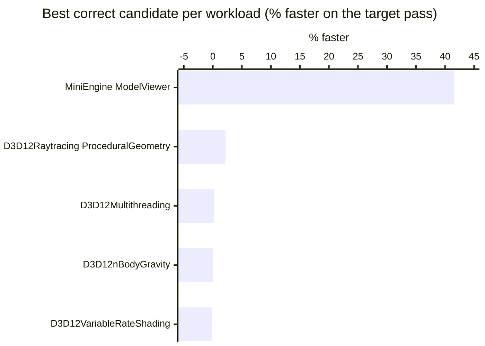
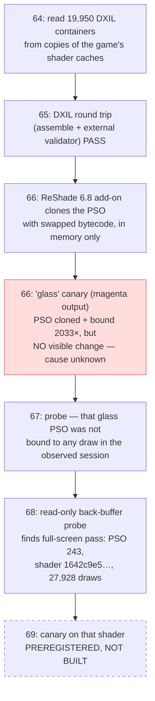

# rdna2-dx12-shader-research

**Where does a DX12 game waste GPU time on an AMD RDNA2 card, and can any of it be won back
without touching the driver?** This is a two-month, evidence-first research log on a
Radeon RX 6950 XT (Navi 21). It covers the AMD driver stack, shader compiler levers, a shader
optimisation pipeline tested on 9 open-source D3D12 workloads, and a final push into the shaders
of a real game (Cyberpunk 2077).

> **Status: paused (2026-10-28).** The author ran out of time, not out of questions. Everything
> needed to pick it up is here: methods, tools, raw measurements, negative results, and an exact
> description of where it stopped. See [Where it stopped](#where-it-stopped) and
> [docs/ROADMAP.md](docs/ROADMAP.md).

## TL;DR

| Question | Answer | Confidence |
|---|---|---|
| Can the AMD shader compiler be tuned from outside the driver? | **No.** `AMD_SC_OPTIONS` is parsed by the retail driver, but only dump options are reachable. The 272 `SCOption_*` flags are report-only. | confirmed |
| Is the DX12 user-mode driver (`amdxc64.dll`) a CPU bottleneck in Fortnite? | **No.** ~2.1% of the critical-path thread (≈0.03 ms/frame). | confirmed |
| Can hand-written shader transformations give real end-to-end gains? | **Yes, once:** −41.4% on a pass and −24.5% GPU frame time on MiniEngine/Sponza, with a byte-identical image. | confirmed (on that workload) |
| Does that method generalise? | **Mostly no.** 1 accepted hit in 9 workloads. The best result everywhere else was −2.2%, below the preregistered threshold. | confirmed |
| Is Cyberpunk 2077 GPU-bound on this machine? | At 1440p, **mostly yes**. At 720p it is limited by something other than the GPU (CPU/submission). | strong / probable |
| Can a Cyberpunk shader be swapped at runtime, reversibly? | The tooling works (DXIL round trip, ReShade add-on, PSO cloning). **The first visible canary failed** for an unknown reason. A better target was found and preregistered, but never tested. | partial |
| Was any game made faster? | **No.** No speed-up is claimed for any game. | — |

## The research arc

```mermaid
flowchart LR
    A["Phase 1<br/>Driver inventory<br/>benchmark harness"] --> B["Phase 1.5<br/>ETW/WPR on Fortnite<br/>UMD settings"]
    B --> C["2A–2E<br/>Compiler options<br/>(closed: no lever)"]
    C --> D["2F–2N<br/>Shader lab: microbench,<br/>optimizer, real shaders,<br/>HW counters"]
    D --> E["2O<br/>Audit + ablations<br/>(what limits the pass?)"]
    E --> F["2P–2R<br/>PoC: −41% pass,<br/>then frozen"]
    F --> G["2T–2U<br/>Hit rate on 8 more<br/>workloads: 0 hits"]
    G --> H["60–63<br/>Cyberpunk baseline,<br/>scaling, WPR"]
    H --> I["64–69<br/>Cyberpunk shader<br/>access + canary"]
    style C fill:#eee,stroke:#999
    style G fill:#eee,stroke:#999
    style I stroke-dasharray: 5 5
```

Grey boxes ended in documented negative results. The dashed box is where the work stopped.

## Key findings

### 1. The driver is not the lever

- The DX12 UMD `amdxc64.dll` **statically links the shader compiler** (6 imports, all Windows).
- `AMD_SC_OPTIONS` / `AMD_SC_CFG_FILE` **are read by the retail driver** and can dump ISA,
  register stats and an optimisation report per shader hash. That gave a working chain
  `shader hash → SC_INPUT XML → RDNA2 ISA → stats` without touching any signed file.
- The 272 `SCOption_*` names only *report* a bitmask; none can be set. 24 compilations with every
  reachable option changed **zero** ISA bytes. On Navi 21, 34 of 272 flags are ever active, and the
  shader-dependent ones are hardware workarounds.
- In Fortnite, `amdxc64.dll` is 0.151 core-equivalents overall but only **2.1%** of the
  critical-path thread. The critical path is 84% `ntoskrnl.exe`.

Reports: [PHASE_1_5_DECISION_GATE.md](research/PHASE_1_5_DECISION_GATE.md),
[10_sc_probe](research/10_sc_probe/), [11_compiler_experiments](research/11_compiler_experiments/PHASE_2E_RESULTS.md),
[13_scoptions_static](research/13_scoptions_static/SCOPTIONS_OBSERVED.md),
[08_etw_fortnite/RESULTS.md](research/08_etw_fortnite/RESULTS.md).

### 2. Shader-level wins are real but rare

The method that produced the one big win:

On **MiniEngine ModelViewer / Sponza**, `stack3_scalar` (68 lines of HLSL diff in one file) gave:

| Metric | Result |
|---|---:|
| `Render Color` pass, GPU busy cycles | **−41.43%** |
| `Render Color`, engine timer (independent) | −40.24% |
| GPU frame, measured | **−24.47%** |
| GPU frame, clock-corrected estimate | −21.78% |
| Image | byte-identical (R11G11B10); float32 within 7 ULP |

Provenance audit: 64 builds, 422 runs, 22 cycles, zero mismatches. Then the same frozen pipeline
was run on 8 more workloads, each named before it was opened:

| Workload | Best *correct* candidate | Verdict |
|---|---:|---|
| MiniEngine ModelViewer (2P) | −41.60% `stack3_scalar` | **accepted** |
| D3D12Raytracing / ProceduralGeometry (2U) | −2.18% `shadow_tmax` (byte-identical, replicated) | rejected: below 4.02% threshold |
| D3D12Multithreading (2T) | −0.22% | rejected: below threshold |
| D3D12nBodyGravity (2R) | 0.00% (compiler already did it) | no-op |
| D3D12VariableRateShading (2T) | +0.13% | rejected |
| D3D12DynamicIndexing, D3D12HDR (2U) | — | closed by the ceiling gate (deleting the whole shader moves < 0.4%) |
| D3D12ExecuteIndirect, D3D12MeshShaders (2T) | — | closed: the pass is 5.76 µs / 480 ns |

**Takeaway:** 1 hit in 9 workloads. The −41% is an outlier, not a rate. The bottleneck is not
generating ideas; it is staying exact *and* clearing the noise threshold. Source:
[research/MEASUREMENT_MEMORY.csv](research/MEASUREMENT_MEMORY.csv),
[POC_FROZEN.md](research/POC_FROZEN.md), [PHASE_2T_RESULTS.md](research/PHASE_2T_RESULTS.md),
[PHASE_2U_RESULTS.md](research/PHASE_2U_RESULTS.md).

### 3. Lessons that cost the most to learn

- **MSBuild silently skipped shader recompilation** when the source was written in the same second
  as the last build, so "A/B" runs measured the same binary twice. Fixed with
  [tools/buildv.py](tools/buildv.py): `-t:Rebuild` plus a check on the compiled shader header hash.
- `TexUnitBusy` in GPUPerfAPI is the **max over 80 CUs**, not a mean. RDNA2 has **160 SIMDs**, not
  320: dividing by 320 halved VALU utilisation (48% → really 96.6%).
- Pairing A/B runs by repetition number instead of by time **would have fabricated an acceptance**
  when the baseline drifted 1.2% between sessions.
- Microbenchmark wins (−77%) can invert in the app (+1.8%): the app never ran that shader, or
  ran it with `DispatchIndirect` on far less data.
- Synthetic corpora teach false rules (`wave64` "always slower" — on real shaders it was the most
  often accepted change).

### 4. Cyberpunk 2077 measurements (driver 32.0.21045.5002)

Fullscreen, Hardware Independent Flip on every frame, built-in benchmark:

| Resolution | FPS | GPU busy ms | GPU wait ms |
|---|---:|---:|---:|
| 1440p (r1) | 112.37 | 8.77 | 0.10 |
| 1080p | 163.97 | 5.85 | 0.20 |
| 720p | 185.83 | 4.17 | 1.11 |
| 1440p (r2) | 111.91 | 8.80 | 0.11 |

Borderless 1440p baseline: 5 runs, mean **112.99 FPS, CV 0.067%**. A WPR CPU+GPU trace of one
run (21 GB ETL, zero lost events, 5304 frames aligned to the native benchmark log) showed game CPU
time split as 48.8% game EXE, 28.4% `ntoskrnl`, 7.9% `amdxc64`. The profiled run ran at
82.6 FPS versus ~112 FPS unprofiled. Tracing overhead is clearly part of that gap, but the full cause was never isolated, so the profiled run is not used as an A/B arm. Reports:
[VERDICT_V2.md](research/62_c2077_fullscreen_scaling/VERDICT_V2.md),
[OFFLINE_ATTRIBUTION_20261016.md](research/63_c2077_wpr_attribution/OFFLINE_ATTRIBUTION_20261016.md).

## Where it stopped

The **next concrete step** is phase 69: build the control and magenta canary for shader
`1642c9e5…` (offline, using [tools/dxil_roundtrip.cpp](tools/dxil_roundtrip.cpp)), check that a
visible marker appears, and only then try a real, correctness-checked transformation. The full
list of open problems is in [docs/ROADMAP.md](docs/ROADMAP.md).

## Repository layout

| Path | What it is |
|---|---|
| [HANDOFF.md](HANDOFF.md) | The detailed state of play, written for whoever picks this up next. **Read first.** |
| [PLAN.md](PLAN.md) | The full phase-by-phase plan and dated log (English translation). |
| [docs/ROADMAP.md](docs/ROADMAP.md) | What is left to do, ranked. |
| [docs/PHASES.md](docs/PHASES.md) | Index of every `research/NN_*` folder with a one-line summary. |
| [CONTRIBUTING.md](CONTRIBUTING.md) | Environment, tools, ground rules, how to run the self-checks. |
| `research/` | One folder per phase: preregistrations, raw CSV/JSON, build logs, verdicts, reports. |
| `tools/` | Python/PowerShell/C++ tooling: capture, parsing, build gates, analysis, the ReShade add-on. |
| `data/` | Manifests (SHA-256) of files that are not in git, and how to get the large ones. |
| `preserved_temp_claude_20260909/` | Source changes to MiniEngine (DirectX-Graphics-Samples) kept from a temp folder. |
| `*.it.md`, `docs/history/` | Italian originals and the original agent notes. |

Most phase reports are in **Italian** (the working language). The README, HANDOFF, PLAN and docs
are in English. Machine translation of individual reports works well; numbers and file names are
unchanged.

## What is not in this repository

To keep it legal and cloneable, these were **excluded** (every file is listed with its SHA-256 in
[data/manifests/excluded_files.csv](data/manifests/excluded_files.csv)):

- AMD driver package/installer, Radeon Developer Tool Suite, Ghidra, Sysinternals tools.
- Cyberpunk 2077 shader caches, extracted DXIL/disassembly, and any payload derived from them.
- ReShade binaries and source copies, third-party SDK DLLs, PDBs, compiled shaders, executables.
- The 21 GB WPR `.etl` traces.
- Verbose MSBuild diagnostic logs.

Large **text** data (PresentMon CSVs, ETW event exports) is attached to the
[GitHub Release](https://github.com/PrimeBuild-pc/rdna2-dx12-shader-research/releases) as zip files. See [data/README.md](data/README.md).

## Hardware and software

RX 6950 XT (Navi 21, `DEV_73A5`) · Ryzen 7 5800X3D · 32 GB · X570 · Windows 11 Pro 26200 ·
Adrenalin 26.8.1 / driver 32.0.21045.5002 for all September measurements (32.0.21045.11001 by
mid-October) · HAGS on.

## License

Code and tools: [MIT](LICENSE). Documentation and measurement data:
[CC BY 4.0](LICENSE-DOCS). Third-party material: [THIRD_PARTY_NOTICES.md](THIRD_PARTY_NOTICES.md).

Not affiliated with AMD, Microsoft, CD PROJEKT RED, Epic Games or Activision. No game files are
redistributed.
